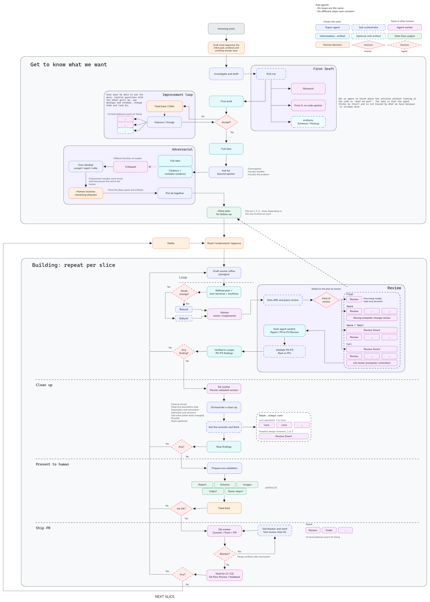
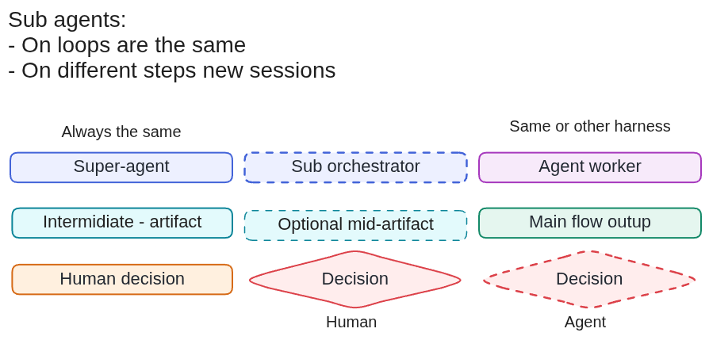
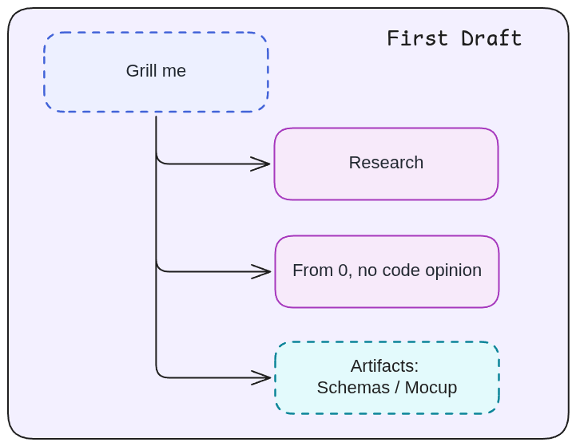
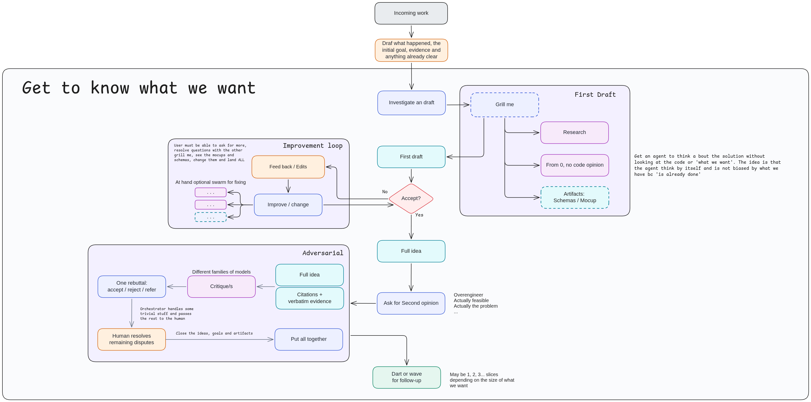
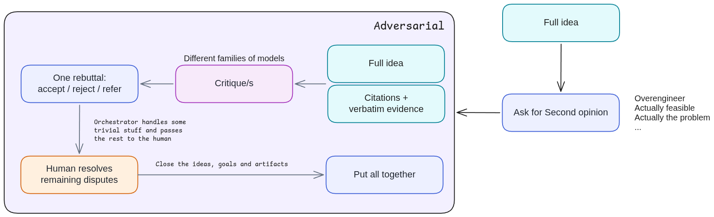
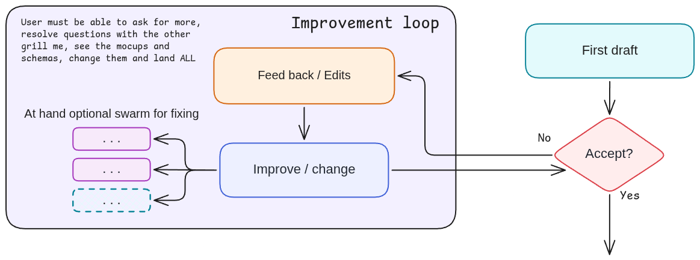
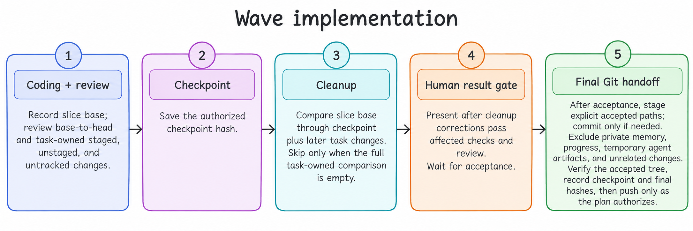
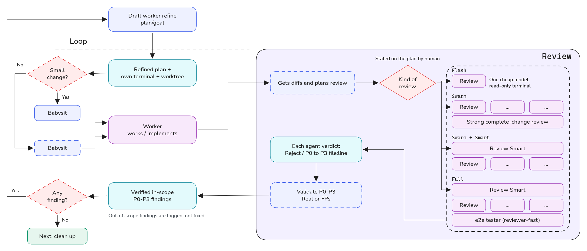
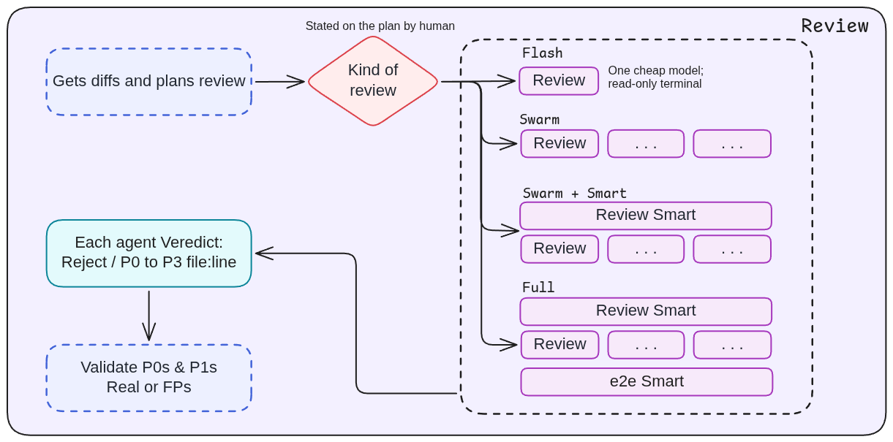

# my-codex-config

Repository-managed Codex configuration with portable shared skills and native Codex
agents. Codex owns its configuration, permissions, hooks, MCP definitions, and synthesis.
Delegation uses an active wrapper's lifecycle when one is present; otherwise it uses the
current harness's native worker tools.
OpenCode configuration remains separately owned by `my-opencode-config`.

## Workflow diagrams



<details>
<summary>Stage diagrams and legend</summary>

### Legend



### First draft



### Planning



### Adversarial review



### Improvement plan loop



### Wave implementation



### Coding loop



### Review



</details>

## Requirements

- macOS or Linux with Bash and Git.
- An app-managed Codex CLI installation.
- Python 3, Node.js, and npm (`npx`).
- `btca` and `headroom` for the configured MCP servers. Bootstrap installs the official
  CodeGraph package when `codegraph` is missing.
- Docker must already be installed and running for the full setup. Bootstrap never installs
  Docker; if Docker is unavailable, it warns and continues without starting SearXNG.
- GitHub CLI (`gh`) authenticated to GitHub for the private-repository clone command.

## Install On Another Computer

Clone the private repository and run the installer:

```bash
gh auth login
gh repo clone MiquelGomezCorral/my-codex-config ~/code/my-codex-config
cd ~/code/my-codex-config
./bootstrap.sh
codex login
```

Use `./bootstrap.sh --pi` to configure Pi, including CodeGraph and local SearXNG MCP tools.
SearXNG is deployed by default with the official Docker image at `http://localhost:8080`.
Use `--no-searxng` to skip its container deployment or `--no-searxng-mcp` to skip Pi's
SearXNG connector; either flag leaves the other part unchanged.
For isolated Pi configuration, run `./bootstrap_pi.sh`; add `--install-extension` to install
Pi Subagents, the MCP adapter, diagram-design, and the SearXNG connector.

Use `./bootstrap.sh --agy` to configure AGY. It writes a `my-codex-config` plugin under
`~/.gemini/config/plugins/`, symlinks the twelve roles into `~/.gemini/config/agents/`, links
the shared skills, and merges `toolPermission`, `artifactReviewPolicy`, and
`enableTerminalSandbox` into `~/.gemini/antigravity-cli/settings.json`. For isolated AGY
configuration, run `./bootstrap_agy.sh`.

Both harness flags are opt-in and independent. `--pi --agy` configures both. If the matching
CLI is not on `PATH`, that harness is skipped with a message and the rest of the install
continues; a missing CLI never fails the bootstrap.

`bootstrap.sh` validates its dependencies and source files before installing. It manages
individual durable entries only; it never replaces or upgrades binaries, reads or links
the complete `~/.codex` runtime directory, or writes under `~/.config/opencode`.
`config/bin/update-codex` is an explicit, opt-in updater for the standalone Codex CLI:
bootstrap links it to `~/.local/bin/update-codex` but never runs it, so upgrading Codex stays
a deliberate user action.

Conflicting managed entries are backed up under
`${XDG_STATE_HOME:-$HOME/.local/state}/my-codex-config/backups/<timestamp>/` with private
permissions. Restart Codex after installation so it reloads config, skills, agents, and
hooks.

CodeGraph does not index projects automatically. In each project where semantic search is
needed, run `codegraph init` and `codegraph index`, then restart Codex or Pi so the MCP
tools are discovered. Pi's SearXNG connector remains installed when the local service is
offline, but search and URL reading report that limitation and do not fall back to paid APIs
or Codex search.

Bootstrap installs `config.toml` and agent TOMLs as private copies because Codex appends
local trust state to the config and rejects symlinked role files. Other immutable managed
entries remain symlinked to the repository.

Verify the installation:

```bash
./bootstrap.sh --check
codex doctor
codex mcp list
```

## Authentication

Codex authentication is manual and never stored in this repository:

```bash
codex login
```

Braintrust MCP uses a bearer token for headless access. Put your Braintrust API key in
each worktree's ignored `.env` as `BRAINTRUST_MCP_TOKEN=<key>`. Launch Codex from that
worktree in its own process with the variable exported; Codex does not load `.env`
automatically:

```bash
set -a
. ./.env
set +a
codex
```

The configured endpoint is for US organizations. EU organizations use
`https://api-eu.braintrust.dev/mcp` in `codex/config.toml`.

## What gets installed where

Each harness receives its own rendering from the same sources. `codex/agents/*.toml` is the
only agent definition; the Pi and AGY role files are generated from it and never committed.

### Codex — `$CODEX_HOME`, default `~/.codex`

| Entry | Mechanism |
| --- | --- |
| `config.toml` | private copy; the runtime tail from `[marketplaces]`, `[plugins]`, `[hooks.state]`, or `[projects]` onward is preserved |
| `hooks.json` | private copy |
| `commands/` | symlink |
| `rules/my-opencode-config.rules` | symlink |
| `agents/<name>.toml`, 12 roles | private copy, because Codex appends trust state and rejects symlinked role files |
| `AGENTS.md` | generated: header, then `config/AGENTS.md`, then `# Security Rules` and `config/security-rules.md` |
| `bin/codex-command-dispatch.mjs` | symlink |
| `vault-context/` | symlink |
| `~/.local/bin/ocr-go` | symlink to `agent-home/skills/review/scripts/ocr-opencode-go` |
| `~/.local/bin/update-codex` | symlink to `config/bin/update-codex`; explicit updater, never run by bootstrap |
| `~/.agents/skills` | symlink to `agent-home/skills` |
| `~/.codex/skills/excalidraw` | synced from an external clone |
| Ponytail, diagram-design | `codex plugin marketplace add` then `codex plugin add` |
| SearXNG | Docker container, unless `--no-searxng` |

The retired `automation-runner` and `commit-worker` agents are backed up and removed from
each harness on every run.

### Pi — `~/.pi/agent`

| Entry | Mechanism |
| --- | --- |
| `agents/<name>.md`, 12 roles | generated from the Codex TOMLs; frontmatter carries `tools`, `thinking`, `skills`, and `allowNestedSubagents` |
| `skills` | symlink to `~/.agents/skills` |
| `mcp.json` | merged, not replaced: the `codegraph` and `searxng` servers, both lazy |
| extensions | only with `--install-extension`: `pi-subagents`, `pi-mcp-adapter@2.34.0`, `diagram-design`, and `mcp-searxng@1.11.1` unless `--no-searxng-mcp` |

### AGY — `~/.gemini/config`

| Entry | Mechanism |
| --- | --- |
| `plugins/my-codex-config/plugin.json` | generated manifest |
| `plugins/my-codex-config/agents/<name>/agent.md`, 12 roles | generated; `subagent: true`, `model: inherit`, `commandExecutionPolicy: eager`, and AGY-native tool names |
| `plugins/my-codex-config/skills` | symlink to `~/.agents/skills` |
| `agents/<name>/agent.md` | symlink to the plugin agent |
| `skills` | symlink to `~/.agents/skills` |
| `~/.gemini/antigravity-cli/settings.json` | merged: `toolPermission`, `artifactReviewPolicy`, `enableTerminalSandbox` |

### The twelve roles

`coder`, `cleanup-worker`, `git-worker`, `review-worker`, `reviewer-quick`,
`reviewer-reasoning`, `reviewer-arch`, `reviewer-e2e`, `coding-supervisor`,
`live-validator`, `critic`, `diagram-worker`.

Pi and AGY give the read-only roles only read tools. That set is `cleanup-worker`,
`coding-supervisor`, `live-validator`, `review-worker`, `critic`, and every `reviewer-*`.
`diagram-worker` may write assigned planning artifacts; its task contract bars product edits,
Git, and delegation. Only `cleanup-worker`, `coding-supervisor`, and `review-worker` may
nest subagents.

## Skills and agents

All shared skills are owned by `agent-home/skills` and installed at `~/.agents/skills`.
Invoke one explicitly with `$skill-name`, for example `$workflow`, `$code`, `$review`,
`$cleanup`, or `$writing`. `$workflow` starts with the idea and evidence, then carries an
approved wave through its PR slices. Standalone stage skills keep their existing stopping behavior. Codex's native behavior
replaces the former OpenCode `build`, `plan`, `general`, `explore`, `answer`, and
`code-reviewer` roles. Twelve focused Codex TOML agents preserve the distinctive worker and
reviewer capabilities. `diagram-worker` creates planning visuals under the workflow's
[diagram guide](agent-home/skills/workflow/references/diagrams.md). All five Git actions use
`git-worker` by default; the `git` skill remains the sole owner of Git policy.

`$workflow` renders a short human view from the complete Markdown plan and a small
`review.json` brief. See the [brief field guide](agent-home/skills/workflow/references/plan-review-template.md)
and [compact example](agent-home/skills/workflow/templates/review.example.json). Existing
Markdown-only renderer calls still work.

Shared product decision records live in each repository's `docs/decisions/`. Only the
human-facing agent uses `agents-memory`: it reads relevant existing repository context and
stores new private working notes, agent decisions, and plans under `agent-memory/` in the
Git common directory shared by linked worktrees. Workers receive the relevant task context
and return memory suggestions to that agent. Existing tracked `.agents/` files remain in
place; separate clones do not share the private directory. Planning assesses applicable
records and includes exact proposed record/index changes for approval; after approval,
the main orchestrator applies those changes
and passes protected invariants to implementation and review workers. Routine work reports no
change, while intent conflicts require user resolution.

Delegating skills load `super-agent`. A proven active wrapper such as Orca owns the
worker lifecycle and exposes eligible harnesses; without a wrapper, delegation stays on
the current harness and uses its native worker tools. Generic mixed swarms keep at least
half their workers, rounded up, on the current harness when no harness preference was
supplied. The review skill prefers Pi reviewers under Orca, preserves explicit AGY/Pi
rosters, and keeps live end-to-end validation on Codex. Outside a wrapper, another harness
requires an explicit documented one-shot adapter; quota substitutions and missing coverage
remain visible.

Cheap worker choices live only in
`agent-home/skills/super-agent/references/model-catalog.yaml`, organized by harness
and the `low`, `medium`, `high`, and `local` tiers. `super-agent` selects models from the
catalog, preferring the cheapest adequate local or online choice for the requested route;
automatic selection and fallback use only compatible catalog entries. Exhausted catalog
choices are reported as blockers instead of using a harness default. `$code` and `$cleanup`
intentionally retain their configured orchestrator-strength models. Pi's Orca route pins
the selected model in a custom terminal and attaches the task through the supervised
worker lifecycle. Explicit cross-harness one-shot adapters are documented by `super-agent`;
they pass catalog values as arguments and never evaluate them as shell code. Pi search
remains on its local SearXNG MCP tools.

The `orchestration`, `orca-cli`, and `computer-use` skills are version-matched discovery
stubs that fetch their guide from the installed binary; their content is intentionally not
duplicated here.

Repository commands keep the OpenCode command-wrapper flow: the command passes its
arguments to one skill, and the skill owns the workflow. Use the `/commands/` namespace
because Codex reserves unqualified slash commands. Everything after the command name is
forwarded exactly as `$ARGUMENTS`.

| Command | Skill |
| --- | --- |
| `/commands/bro` | `bro` |
| `/commands/cleanup` | `cleanup` |
| `/commands/code` | `code` |
| `/commands/commit` | `git` |
| `/commands/index` | `codegraph-setup` |
| `/commands/init` | `agents-memory` |
| `/commands/merge` | `git` |
| `/commands/workflow` | `workflow` |
| `/commands/refine-plan` | `refine-plan` |
| `/commands/review-findings` | `review-findings` |
| `/commands/review-plan` | `review-plan` |
| `/commands/review-pr-comments` | `git` |
| `/commands/review` | `review` |

For example, `/commands/review quick focus on the payment path` invokes `review` with
`quick focus on the payment path` as its arguments. Direct `$skill-name` invocation also
remains available.

The `$review --preset` values are `flash`, `swarm`, `swarm-smart`, and `full`, for one
brief reviewer, adaptive swarm, verified swarm synthesis, or authorized live end-to-end
validation. OCR stays a separate explicit `$review --ocr` opt-in. Install OCR separately,
then authenticate `opencode-go` in Pi with `/login`; Pi is only the credential store, not
the review harness. The review helper calls OpenCode Go directly, defaults to
`deepseek-v4-flash`, and stores no credential or session state in this repository. Set
`OCR_OPENCODE_GO_MODEL` before launching the harness to select another Go model. Without
Pi, provide `OPENCODE_API_KEY` through the approved secret store.

```bash
npm install -g @alibaba-group/open-code-review
pi auth check --provider opencode-go --no-refresh
ocr --version
```

From any repository, run `ocr-go review --preview` and then `ocr-go review`.

Ponytail is installed from `DietrichGebert/ponytail` during bootstrap. Its skills, hooks,
and commands are maintained by that plugin rather than copied into this repository. Review
and trust its three lifecycle hooks in Codex once after the first install or a hook update.

`diagram-design` is installed from the `cathrynlavery/diagram-design` marketplace plugin for
Codex and through Pi's native extension installer. AGY does not install the package. The
Excalidraw skill is synced from `fabricioartur/codex-excalidraw-skill` into
`~/.codex/skills/excalidraw`; it remains Codex-only.

### Attribution

The `writing` skill's natural-writing rules merge two upstream sources:

- [petergyang/no-ai-slop](https://github.com/petergyang/no-ai-slop/blob/main/skills/no-ai-slop/SKILL.md)
  (MIT) — editing principles, voice preservation, pattern list.
- [Humanize by Rich Tabor](https://github.com/richtabor/agent-skills/tree/main/skills/humanize),
  also listed as `natural-writing-humanizer` on MCP Market, derives its catalogue from
  [Wikipedia's "Signs of AI writing"](https://en.wikipedia.org/wiki/Wikipedia:Signs_of_AI_writing)
  (WikiProject AI Cleanup, CC BY-SA) — rule identifiers, individual reference impacts,
  scoring framework, and the coverage, no-new-patterns, and genre safeguards.

The adaptation treats patterns as contextual heuristics, retaining source exceptions and
the writer's preferences. It uses individual reference impacts instead of Humanize's
inconsistent category-level summary. Its optional score retains the HIGH/MEDIUM deductions,
treats LOW findings as advisory, avoids duplicate deductions, and measures checklist
findings only; it is not a validated quality or authorship measure.

The personal voice profile is built from Miquel's own 100-question interview, using the
interview and anti-overfitting method in [Ruben Hassid's "I am just a text file"](https://ruben.substack.com/p/i-am-just-a-text-file).

That full interview is stored verbatim at
`agent-home/skills/writing/references/voice-interview.md` (100 questions, 7 sections, plus
the post-interview calibration). It is the source material. The operating profile the
agent reads by default is the compressed `voice-profile.md`, which carries only the rules,
the boundaries, the quick reference card, and the anti-overfitting guide. The upstream
article link above is the standing reference for regenerating or extending the interview.

The `test-audit` skill adapts [OpenClaw's `test-audit`](https://github.com/openclaw/openclaw/blob/main/.agents/skills/test-audit/SKILL.md)
(MIT, OpenClaw Foundation). Its value bar, junk patterns, retention bar, candidate evidence,
edit shape, and campaign phases are kept. Its OpenClaw-specific skill names, Vitest scripts,
and PR flow are replaced by this repository's own test commands and the `git` skill.

The workflow renderer bundles selected [Lucide](https://github.com/lucide-icons/lucide)
SVGs. Lucide's ISC notice and the MIT notice for Feather-derived icons are in
`agent-home/skills/workflow/licenses/lucide.LICENSE`.

The `skill-scout` skill replaces the former `find-skills` and `skillspector` skills, folding
their marketplace discovery and static security scan into one find-vet-catalog flow. Its
`references/evidence.md` cites the measurements it reasons from:
[SWE-Skills-Bench](https://arxiv.org/abs/2603.15401),
[SkillsBench](https://arxiv.org/abs/2605.31408), and a study of 34,000 real skills reported
by The Decoder.

## Repository ownership

Workers use the active wrapper's documented lifecycle or the current harness's native
lifecycle. Retained sessions resume only when their parent, harness, role, model, and
directory still match. This repository does not install or authenticate another harness.

`my-opencode-config` remains the owner of OpenCode's `config/skills/` and
`config/commands/`. It is a separate rollback path and is not modified or installed by
this repository; an already-exposed OpenCode agent may still be selected by the portable
routing policy.

Vault Context is explicit-only:

```bash
node "${CODEX_HOME:-$HOME/.codex}/vault-context/bin/search.mjs" --prompt "search text"
```

No prompt hook performs Vault search, and no OpenCode plugin adapter is installed in
Codex.

## Check

```bash
./bootstrap.sh --check
bash tests/bootstrap.test.sh
node --test tests/*.mjs config/plugins/vault-context/test/plugin.test.mjs
```

The first command is the minimum readiness check. The isolated-home test uses temporary
directories and does not install into a live home or require authentication.

## Rollback

The existing OpenCode installation remains untouched. Stop using the Codex configuration,
then run `my-opencode-config`'s documented bootstrap or restore its prior links. This
repository does not install or upgrade OpenCode.

## Never commit

- Credentials, auth state, sessions, histories, databases, logs, caches, memories,
  installation IDs, or plugin caches.
- Machine-specific absolute paths or private connection data.
- Generated dependencies such as `node_modules`.
