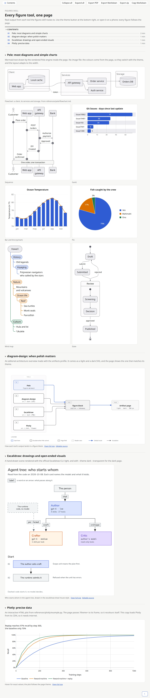

# figures

Visual evidence for anything an agent shows the user. The skill picks the tool (Pele, then
diagram-design, then Excalidraw, then Plotly) and makes every figure match the artifact pages in
light and dark. Routing lives in [`SKILL.md`](SKILL.md).

The [demo page](demo/index.html) puts real output from all four tools on one artifact page. Open it
from a clone in a browser to switch themes, hover the plot and use the page buttons. Its Plotly panel
loads Plotly (about 4.8 MB) from its CDN, so that panel needs internet; the other figures do not.
GitHub can only show the page as the picture below, which follows your GitHub theme.

<a href="demo/index.html">
  <picture>
    <source media="(prefers-color-scheme: dark)" srcset="demo/page-dark.webp">
    
  </picture>
</a>
