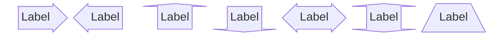
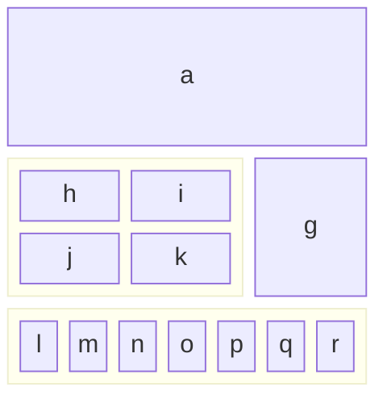

# Block

Use for: Block layouts on a grid: system boxes of different widths, groups and arrow blocks, when a flowchart would reorder what you placed.

Keyword: `block`

Source: pele.run examples (MIT), Pele 1.6.0. Full gallery: [Block examples](https://pele.run/examples/block).
