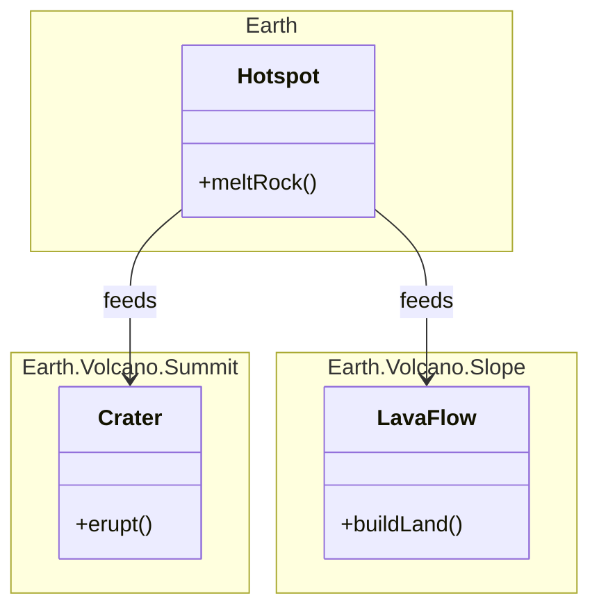
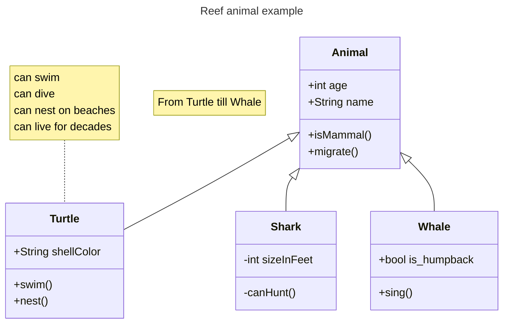

# Class

Use for: Classes, interfaces, fields and methods with inheritance and composition (UML class view of code).

Keyword: `classDiagram`

Source: pele.run examples (MIT), Pele 1.6.0. Full gallery: [Class examples](https://pele.run/examples/class).
