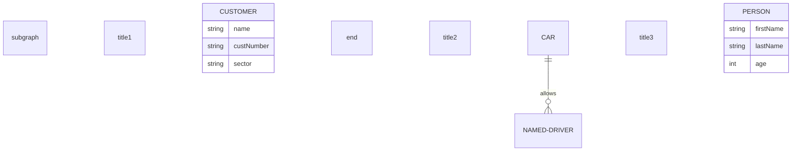
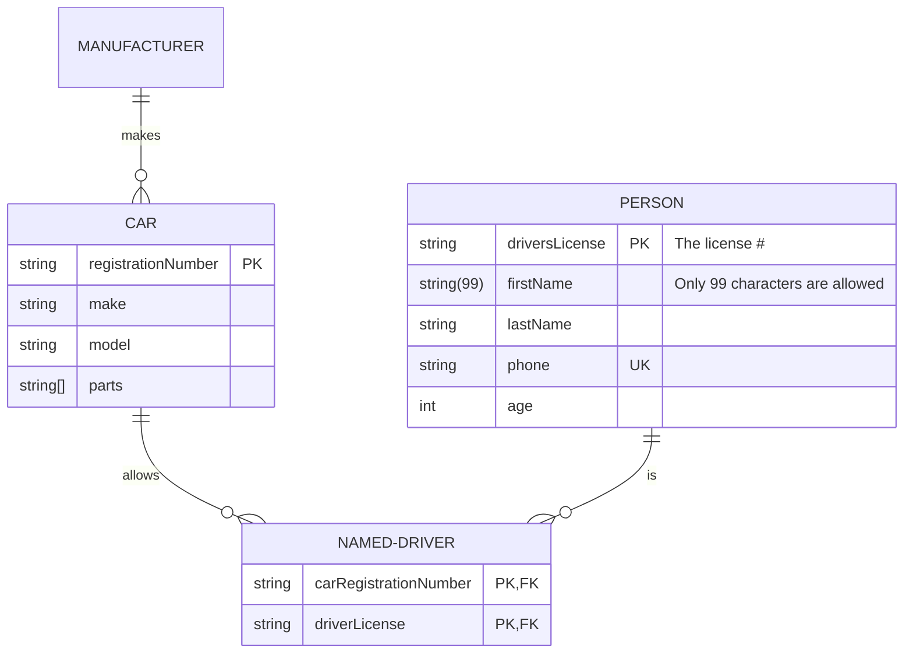
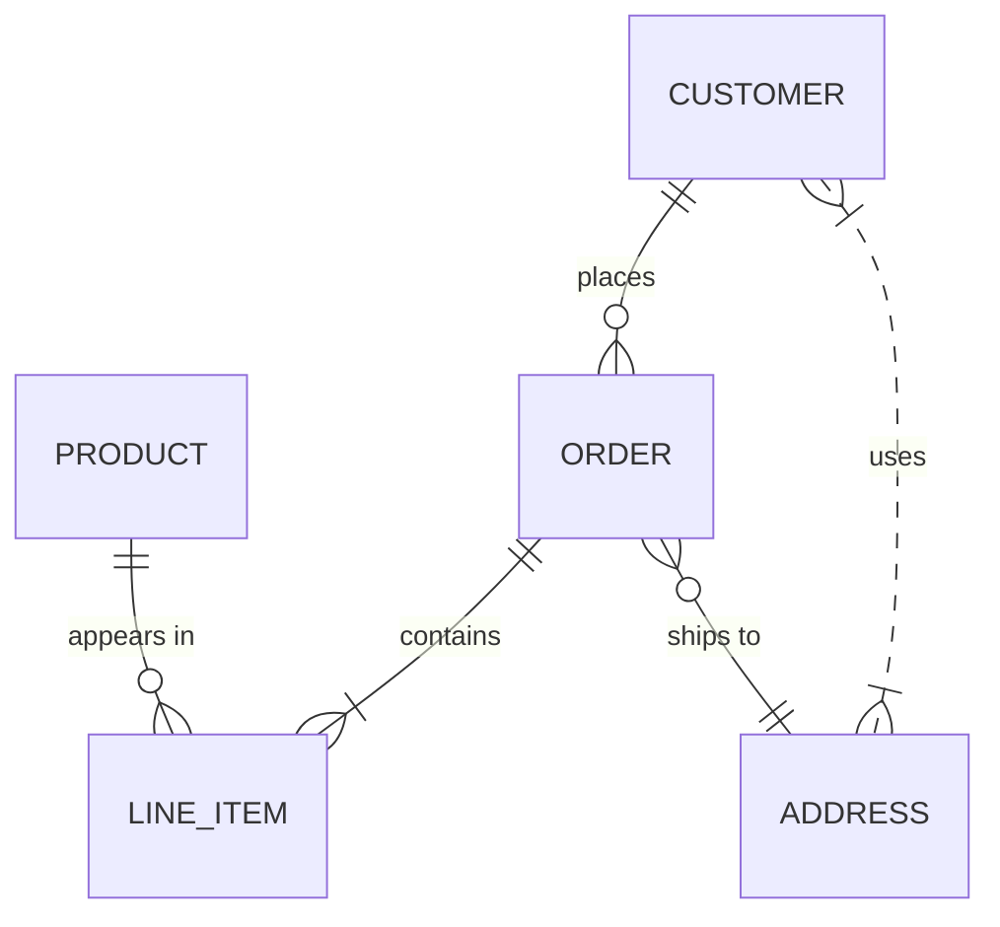

# Entity relationship

Use for: Database entities, their keys and how they relate (one-to-many and so on).

Keyword: `erDiagram`

Entities with several relationships:

Source: pele.run examples (MIT), Pele 1.6.0. Full gallery: [Entity relationship examples](https://pele.run/examples/er).
