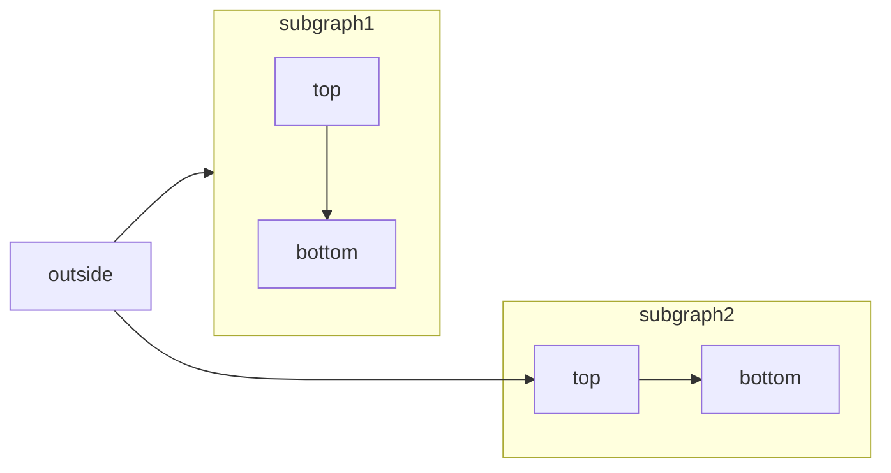
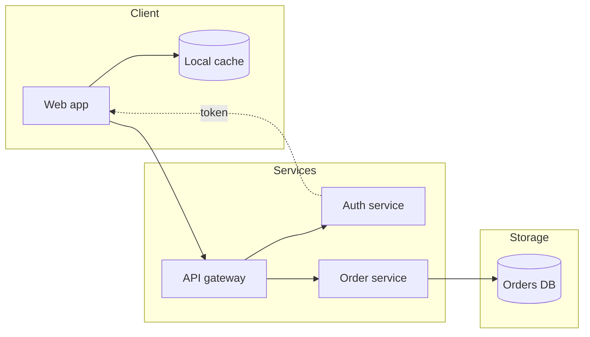
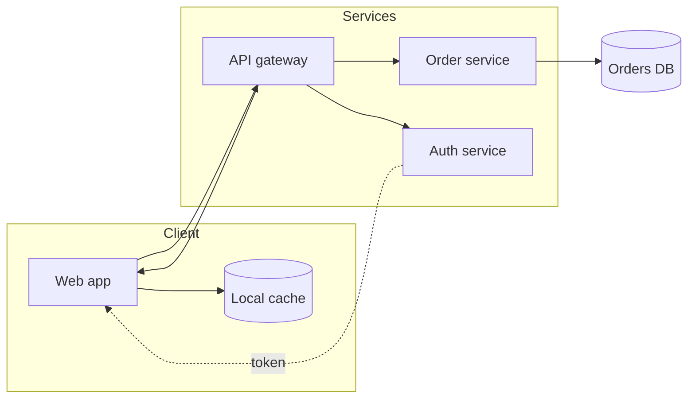

# Flowchart

Use for: Steps and decisions of a process, pipelines, dependency graphs and grouped system views. The default for "how does it flow".

Keyword: `flowchart`

Two-way between groups:

Source: pele.run examples (MIT), Pele 1.6.0. Full gallery: [Flowchart examples](https://pele.run/examples/flowchart).
