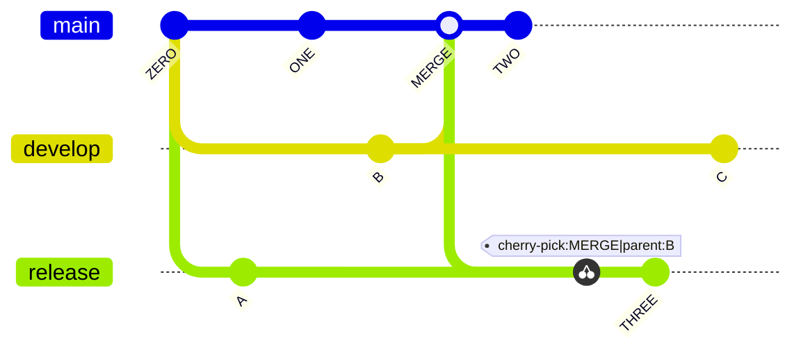
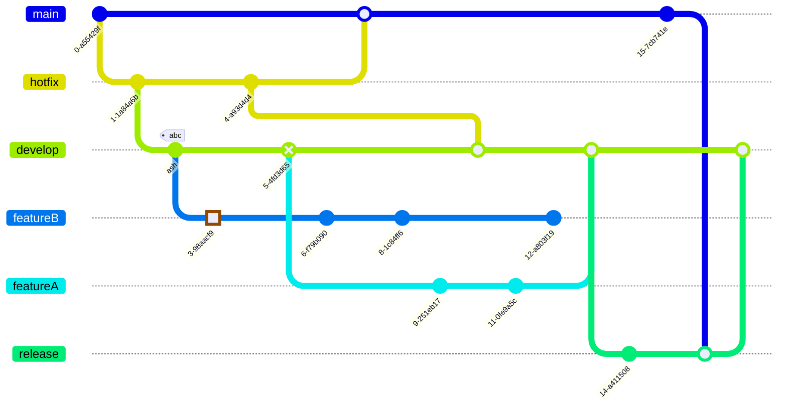

# Git graph

Use for: Branches, commits, merges and tags of a Git history.

Keyword: `gitGraph`

Source: pele.run examples (MIT), Pele 1.6.0. Full gallery: [Git graph examples](https://pele.run/examples/git).
