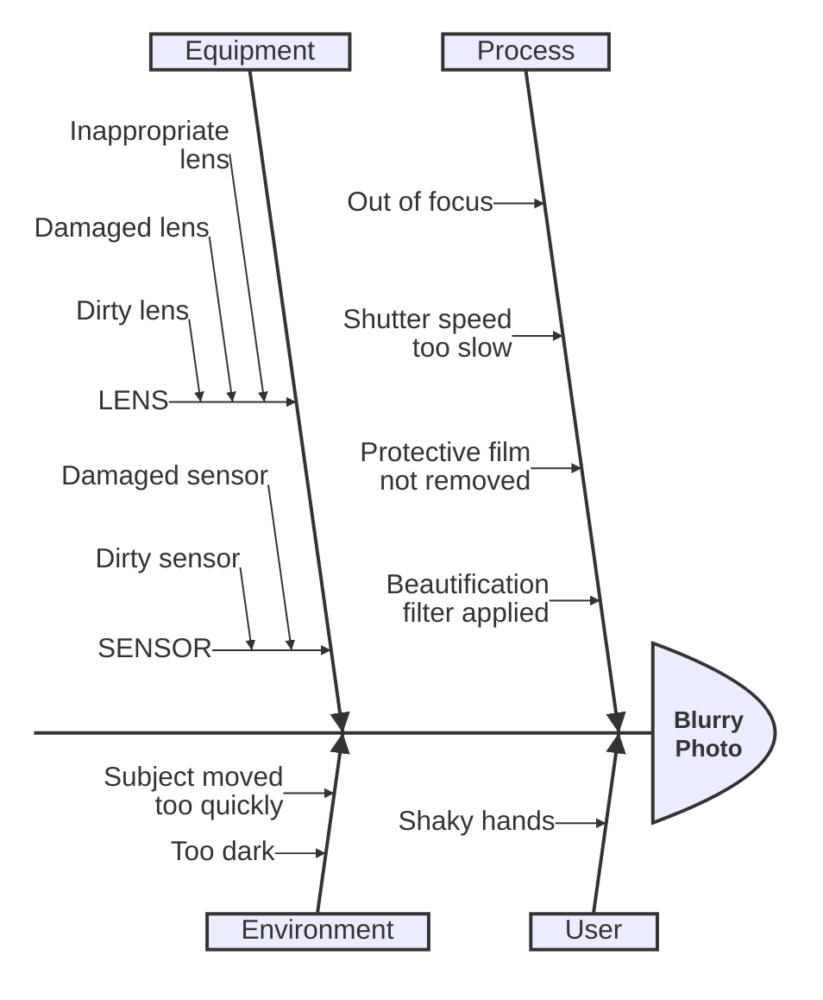

# Ishikawa

Use for: Root-cause analysis: causes grouped by category around one effect (fishbone).

Keyword: `ishikawa-beta`

Source: pele.run examples (MIT), Pele 1.6.0. Full gallery: [Ishikawa examples](https://pele.run/examples/ishikawa).
