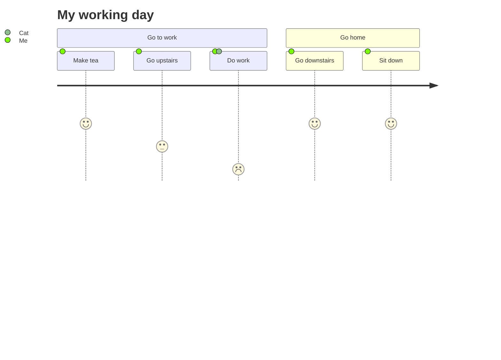

# User journey

Use for: What a person does across stages of an experience and how each step feels (score 1 to 5).

Keyword: `journey`

Source: pele.run examples (MIT), Pele 1.6.0. Full gallery: [User journey examples](https://pele.run/examples/journey).
