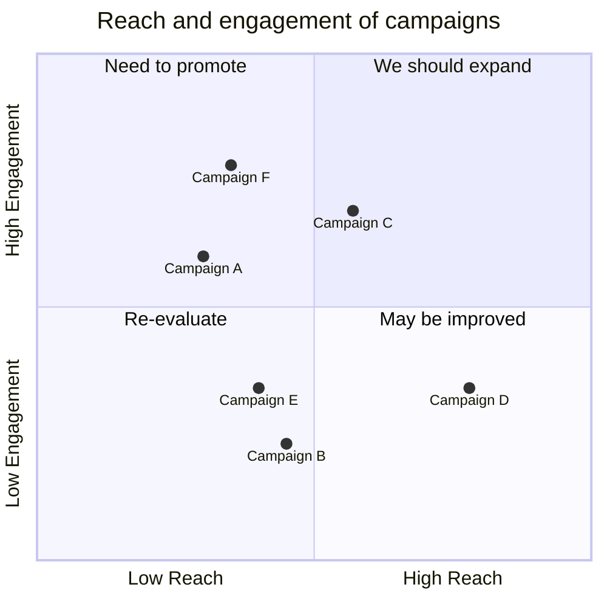

# Quadrant chart

Use for: Items placed on two axes (effort and impact, risk and value) with labelled quadrants.

Keyword: `quadrantChart`

Source: pele.run examples (MIT), Pele 1.6.0. Full gallery: [Quadrant chart examples](https://pele.run/examples/quadrant).
