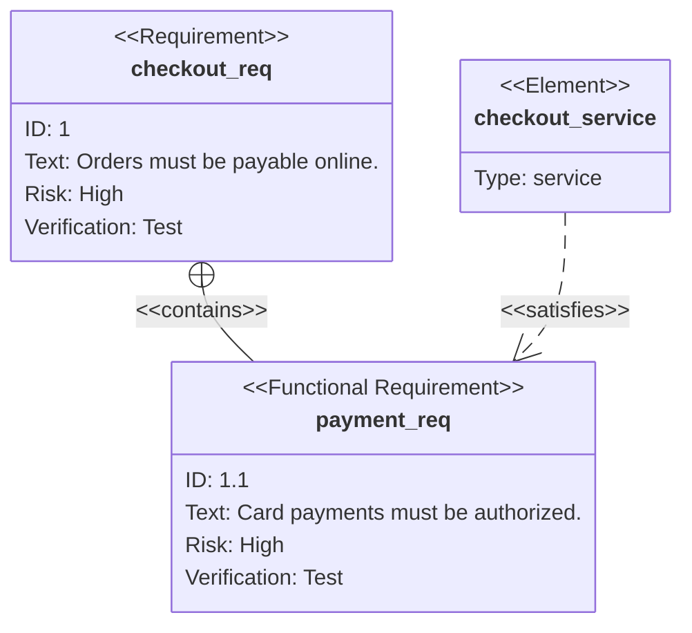
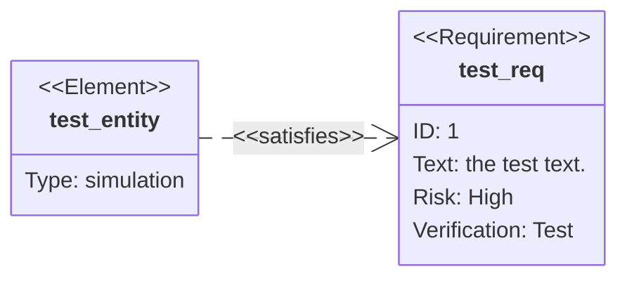

# Requirement

Use for: Requirements, the elements that satisfy them and how each is verified.

Keyword: `requirementDiagram`

Source: pele.run examples (MIT), Pele 1.6.0. Full gallery: [Requirement examples](https://pele.run/examples/requirement).
