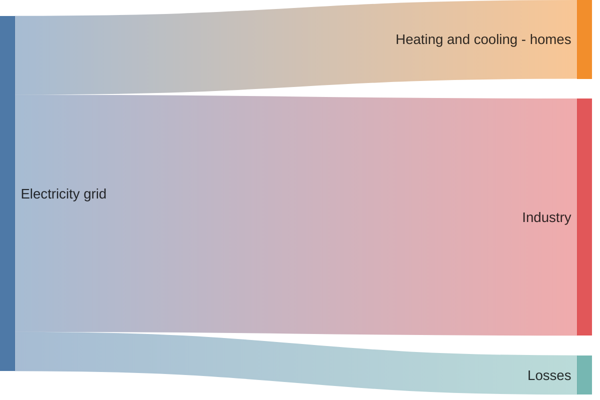
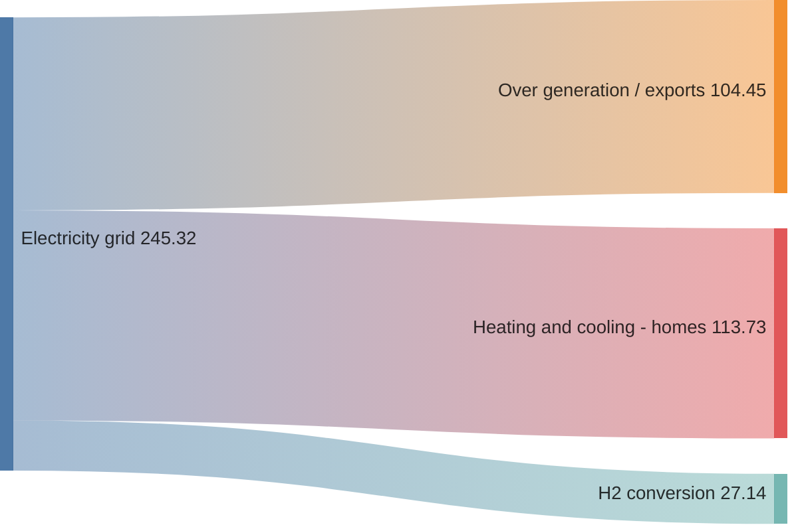

# Sankey

Use for: A quantity that splits and merges between stages; band width is the amount.

Keyword: `sankey`

Source: pele.run examples (MIT), Pele 1.6.0. Full gallery: [Sankey examples](https://pele.run/examples/sankey).
