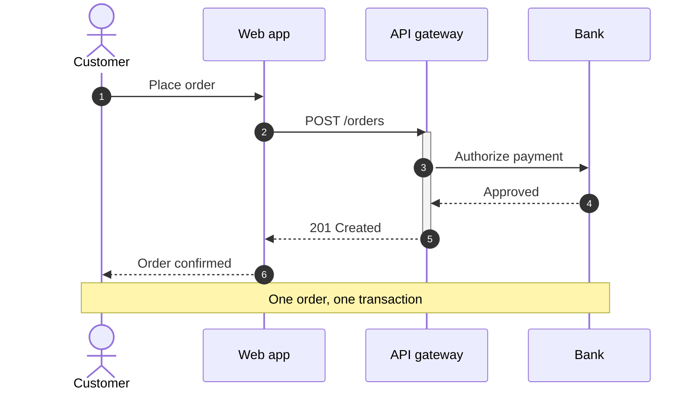
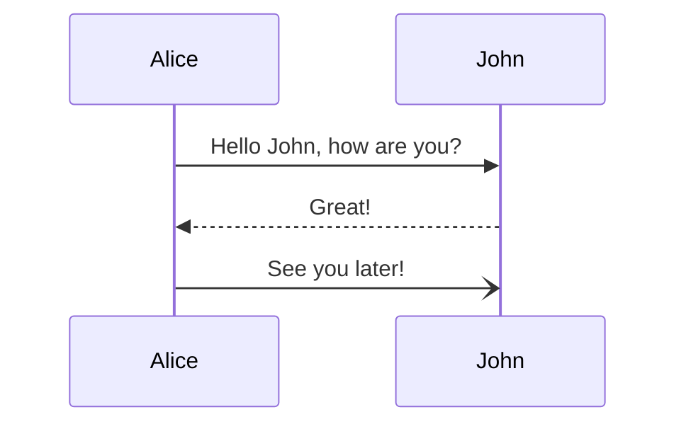
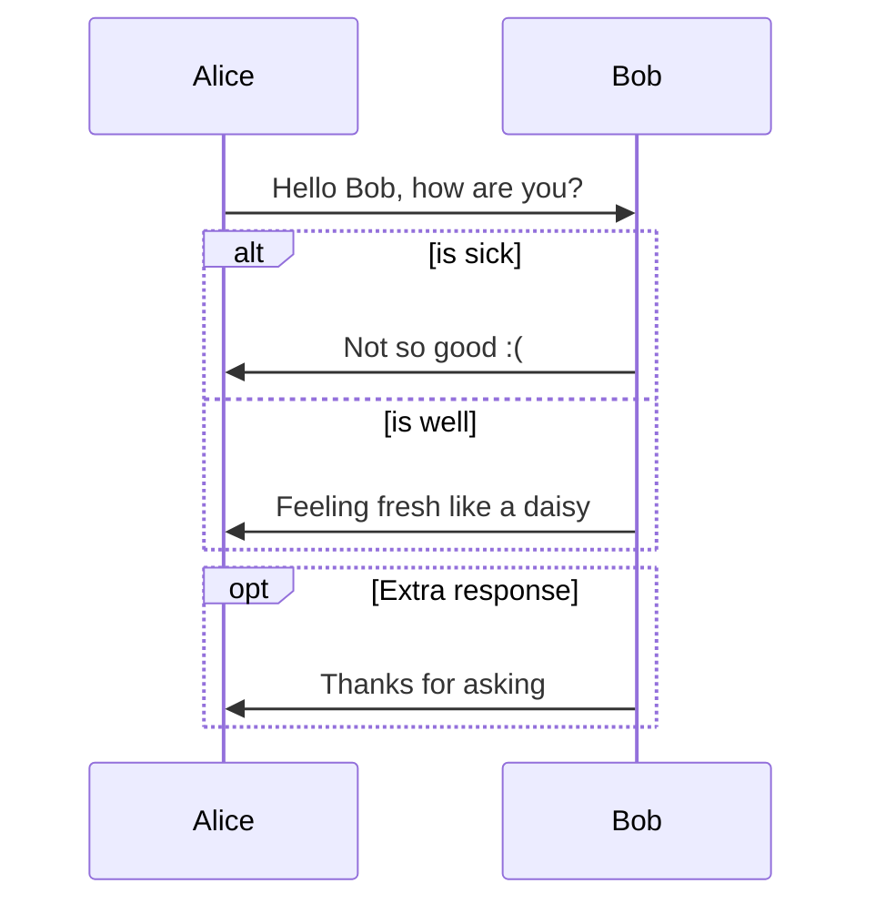

# Sequence

Use for: Messages between actors over time: API calls, protocols, handshakes, with loops, alternatives and notes.

Keyword: `sequenceDiagram`

Alternatives and optional replies:

Source: pele.run examples (MIT), Pele 1.6.0. Full gallery: [Sequence examples](https://pele.run/examples/sequence).
