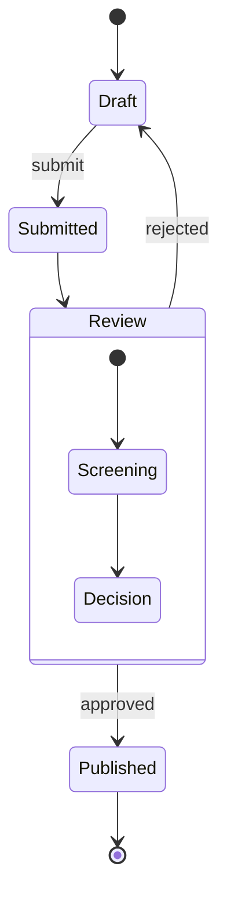
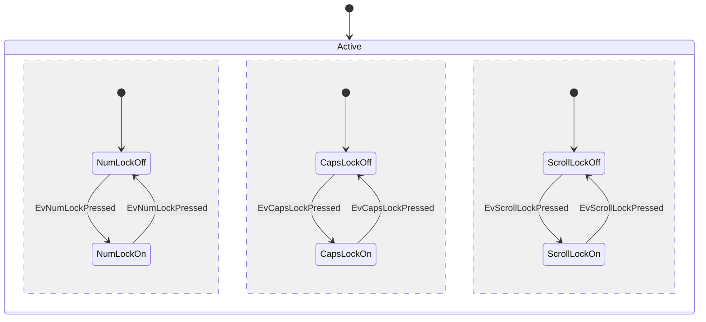
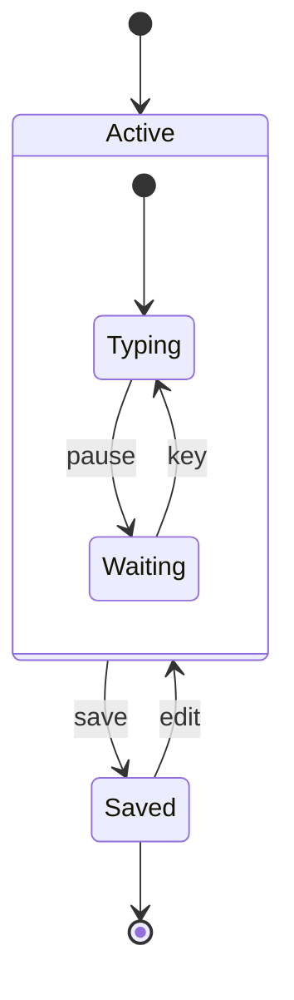

# State

Use for: States of one thing and the transitions between them, with composite states.

Keyword: `stateDiagram-v2`

Composite state:

Source: pele.run examples (MIT), Pele 1.6.0. Full gallery: [State examples](https://pele.run/examples/state).
