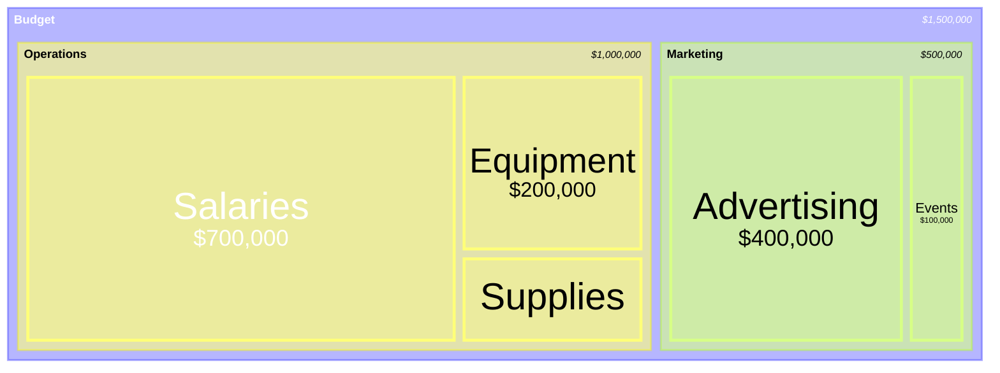
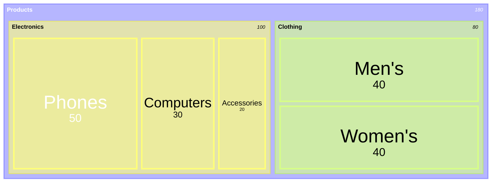

# Treemap

Use for: Part-of-whole where nested rectangle area is the amount (disk use, budget).

Keyword: `treemap-beta`

Source: pele.run examples (MIT), Pele 1.6.0. Full gallery: [Treemap examples](https://pele.run/examples/treemap).
