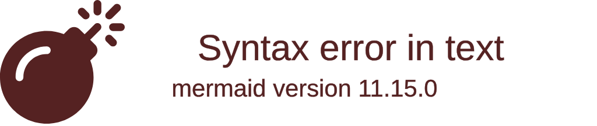

# Tree view

Use for: A file or folder tree, optionally with file icons.

Keyword: `treeView-beta`

Source: pele.run examples (MIT), Pele 1.6.0. Full gallery: [Tree view examples](https://pele.run/examples/treeview).
