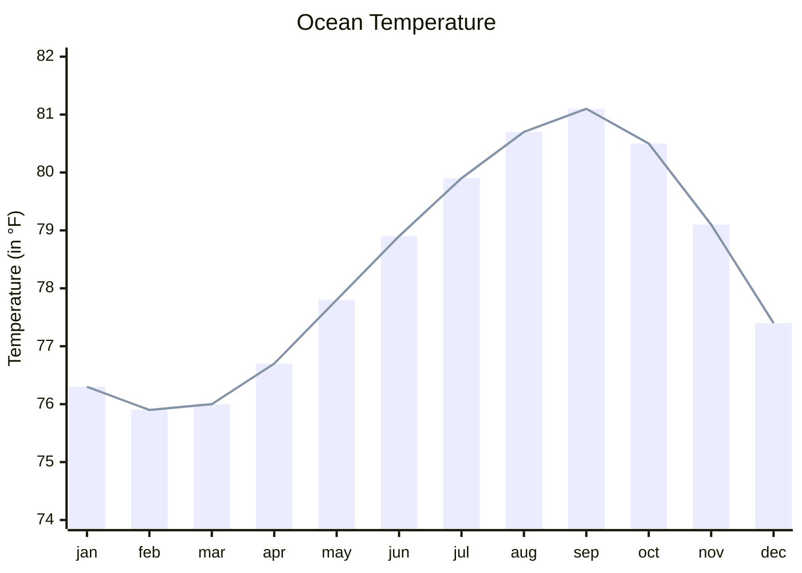
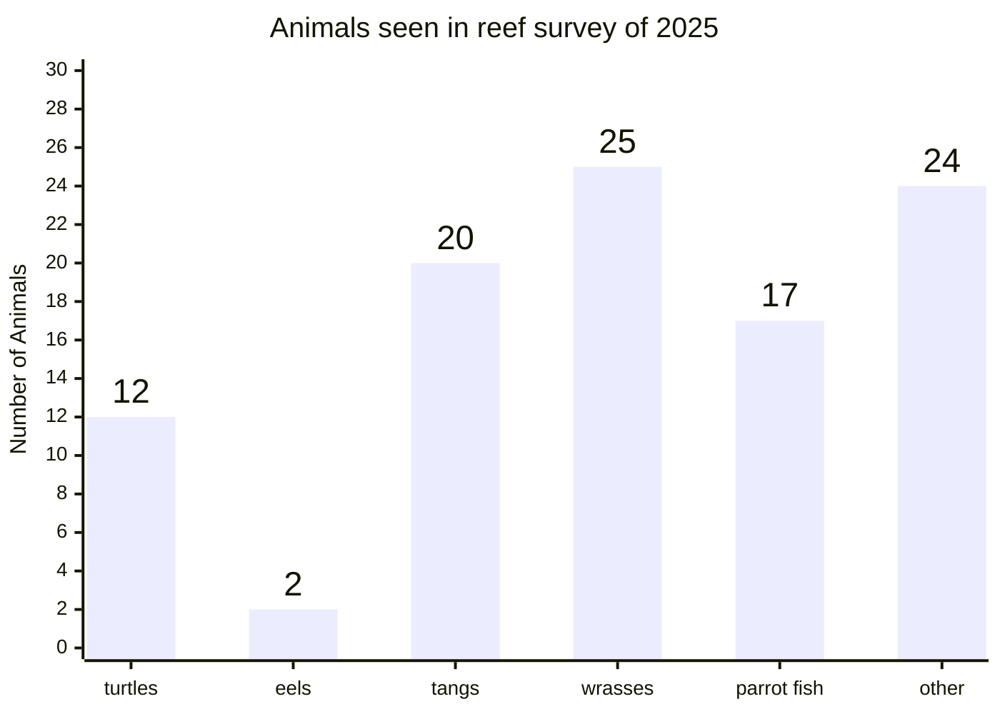

# XY chart

Use for: Bars and lines over categories or a numeric axis: the simple chart. Use plotly for real data.

Keyword: `xychart`

Source: pele.run examples (MIT), Pele 1.6.0. Full gallery: [XY chart examples](https://pele.run/examples/xychart).
